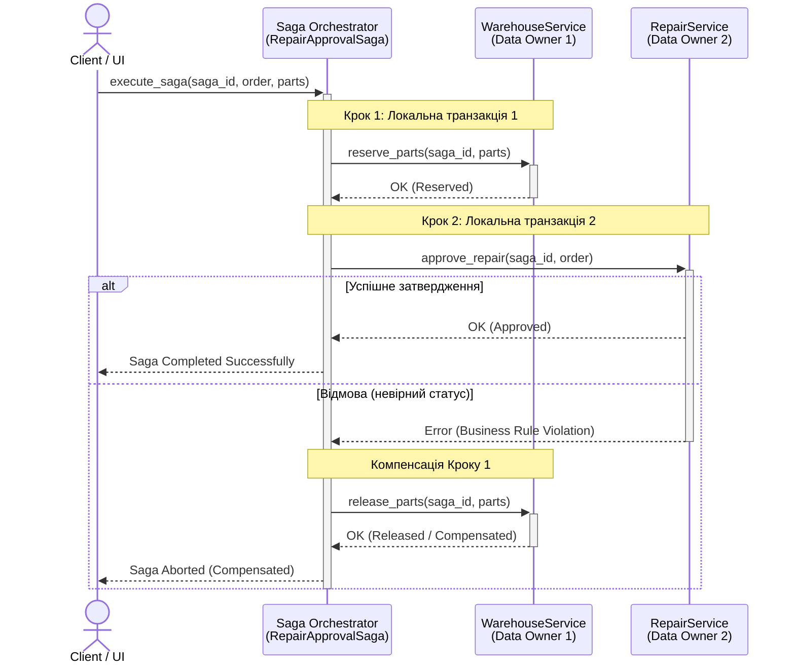

# Звіт з Лабораторної роботи №3

**Тема:** Взаємодія компонентів і узгодженість даних. Патерн Saga  
**Дисципліна:** Проєктування ПЗ та хмарної інфраструктури  
**Проєкт:** TechRepair Hub (Система керування ремонтом комп'ютерної техніки)
**Автор** Студент групи СПм-51 Чорнописький Богдан Тарасович

---

## 1. Визначення процесу та учасників

Для дослідження патерна Saga обрано процес **«Затвердження ремонту з резервуванням деталей на складі»**. 

**Учасники та власники даних:**
1. **WarehouseService (Власник даних 1):** Керує залишками запчастин на складі (`inventory`).
2. **RepairService (Власник даних 2):** Керує життєвим циклом заявок на ремонт (`orders_status`).
3. **RepairApprovalSaga (Оркестратор):** Координує виконання локальних транзакцій та керує компенсаціями.

---

## 2. Контракти команд та компенсація

Усі команди містять `saga_id` для забезпечення ідемпотентності (захисту від дублювання).

*   **Крок 1 (WarehouseService):** `reserve_parts(saga_id, part_id, quantity)`
    *   Локальна операція: зменшення залишку запчастини на складі.
*   **Крок 2 (RepairService):** `approve_repair(saga_id, order_id)`
    *   Локальна операція: переведення статусу заявки з `WAITING_FOR_APPROVAL` у `IN_PROGRESS`.
*   **Компенсація Кроку 1 (WarehouseService):** `release_parts(saga_id, part_id, quantity)`
    *   Локальна операція: повернення зарезервованої запчастини на баланс складу. Викликається, якщо Крок 2 завершується невдало.

---

## 3. Діаграма послідовності

Архітектуру взаємодії та процес компенсації задокументовано у форматі PlantUML.  
**[Діаграма послідовності Saga]**

---

## 4. Результати перевірок (Тестування)

Реалізовано 4 автоматизовані перевірки (pytest), які підтверджують коректність роботи оркестратора.

### 4.1. Успішний процес
*   **Початковий стан:** Залишок деталей = 5, Статус = `WAITING_FOR_APPROVAL`.
*   **Дія:** Виконання саги.
*   **Кінцевий стан:** Залишок деталей = 4, Статус = `IN_PROGRESS`.
*   **Журнал:** `START SAGA` $\rightarrow$ `SUCCESS: Parts reserved` $\rightarrow$ `SUCCESS: Order approved`.

### 4.2. Відмова другого кроку з компенсацією
*   **Початковий стан:** Залишок деталей = 5.
*   **Дія:** Крок 2 відхиляє зміну статусу через бізнес-правило.
*   **Кінцевий стан:** Залишок деталей = 5 (деталь повернуто). Статус заявки не змінився.
*   **Журнал:** `ERROR: Business Rule Violation` $\rightarrow$ `COMPENSATED: Parts released`.

### 4.3. Повтор команд без повторного ефекту (Ідемпотентність)
*   **Початковий стан:** Сага вже успішно виконана (залишок = 4).
*   **Дія:** Повторний виклик команди з тим самим `saga_id`.
*   **Кінцевий стан:** Залишок залишається = 4. Система розпізнає команду як виконану (`processed_commands`) і не списує деталь вдруге.

### 4.4. Помилка компенсації з подальшим повтором
*   **Початковий стан:** Відмова на Кроці 2, ініційовано компенсацію, але вона падає (наприклад, недоступність сервісу складу).
*   **Стан після збою:** Сага повертає статус `COMPENSATION_FAILED`. Деталь "зависла" в резерві (залишок = 4).
*   **Дія (Retry):** Усунення проблеми та прямий повторний виклик `release_parts`.
*   **Кінцевий стан:** Компенсація успішна, залишок деталей = 5.

---

## 5. Обмеження локальної симуляції

У поточній реалізації стан Оркестратора, журнал, а також списки виконаних команд (`processed_commands` для ідемпотентності) зберігаються в оперативній пам'яті (in-memory). 

**Наслідки перезапуску процесу:**
Якщо додаток впаде або сервер буде перезавантажено:
1. Втратиться історія вже оброблених `saga_id`, що зробить систему вразливою до дублювання (порушення ідемпотентності).
2. Загубиться інформація про "підвислі" саги (наприклад, ті, що зупинилися на етапі `COMPENSATION_FAILED`), що унеможливить автоматичний Retry.

**Рішення для Production:** Для реальних систем стан Saga (State Machine) та ключі ідемпотентності повинні зберігатися у персистентних базах даних. Взаємодія має відбуватися через надійні черги повідомлень (Message Brokers, наприклад, RabbitMQ або Kafka) із застосуванням патерна Transactional Outbox.