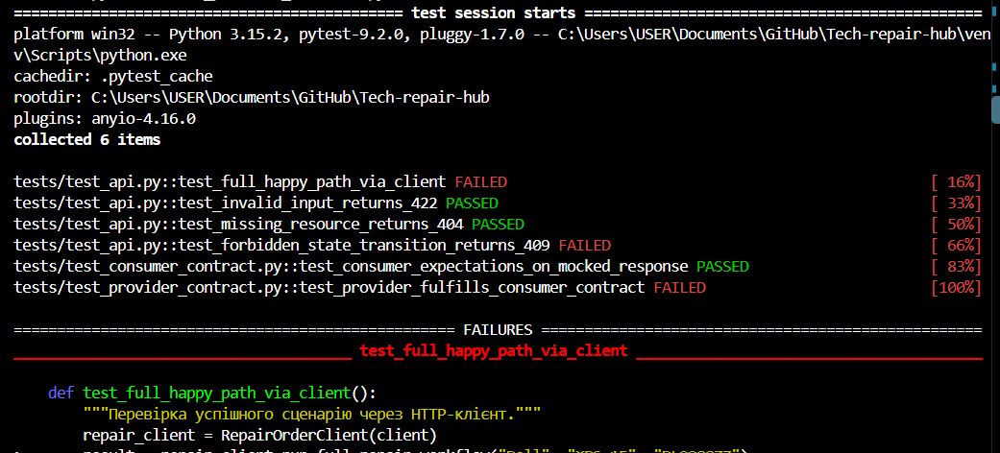
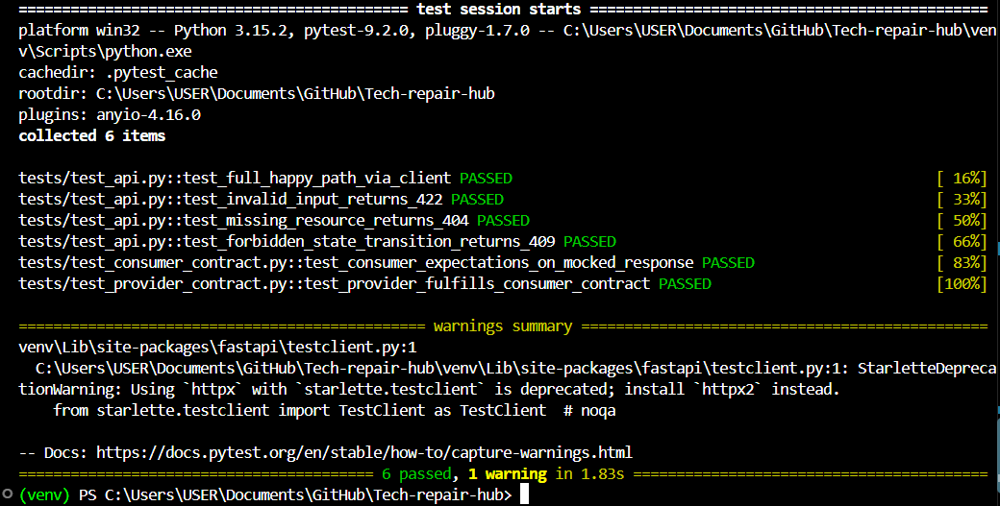

# Звіт з Лабораторної роботи №5

**Тема:** Проєктування API та перевірка контрактів  
**Дисципліна:** Проєктування ПЗ та хмарної інфраструктури  
**Проєкт:** TechRepair Hub (Система керування ремонтом комп'ютерної техніки)
**Автор** Студент групи СПм-51 Чорнописький Богдан Тарасович

---

## 1. Ресурс, власник даних та життєвий цикл

* **Ресурс:** Заявка на ремонт — `/api/v1/repair-orders`.
* **Власник даних:** Доменний сервіс `RepairService` (`RepairOrder` + `InMemoryRepairOrderRepository` із ЛР 2). Зовнішні клієнти не мають прямого доступу до сховища й взаємодіють із заявками виключно через HTTP-контракт.
* **Допустимі переходи станів:**
  `NEW` $\rightarrow$ `IN_DIAGNOSTICS` $\rightarrow$ `WAITING_FOR_APPROVAL` $\rightarrow$ `IN_PROGRESS` $\rightarrow$ `COMPLETED`.
  Порушення порядку переходів або спроба розпочати ремонт без діагностики блокується доменними винятками (`InvalidStateTransitionException`, `DiagnosticRequiredException`) і повертає `409 Conflict`.

### Операції та статус-коди

| Операція | Метод і шлях | Успішний код | Коди помилок |
| :--- | :--- | :---: | :--- |
| Створення заявки | `POST /api/v1/repair-orders` | `201 Created` | `422 Unprocessable Entity` |
| Читання заявки | `GET /api/v1/repair-orders/{order_id}` | `200 OK` | `404 Not Found` |
| Зміна стану | `PATCH /api/v1/repair-orders/{order_id}/status` | `200 OK` | `404`, `409 Conflict`, `422` |

---

## 2. Специфікація OpenAPI та вибір стилю API

* Контракт HTTP API описано у форматі **OpenAPI 3.1.1**: [`docs/openapi.yaml`](./openapi.yaml).
* Порівняння **REST**, **gRPC** та **GraphQL** за вимогами системи (кешування читання, простота інтеграції та супроводу) і фіксація вибору **REST** оформлені в архітектурному рішенні: [`docs/adr/003-api-style.md`](./adr/003-api-style.md).

---

## 3. Реалізація адаптера, клієнта та автоматичних перевірок

* **API-адаптер (`src/api/app.py`):** Тонкий HTTP-шар на базі `FastAPI`, який перетворює запити у виклики доменного агрегата `RepairOrder` та мапить доменні винятки на HTTP-статуси.
* **Клієнт (`src/client/repair_client.py`):** Реалізований на `httpx`, виконує повний сценарій життєвого циклу заявки (`POST` $\rightarrow$ `GET` $\rightarrow$ серія `PATCH` до `COMPLETED`).
* **Контракт споживача (`contracts/repair_order_contract.json`):** Фіксує очікуваний статус (`201`), обов'язкові поля (`id`, `status`, `diagnostic_completed`, `device`) та їхні типи.
* **Автоматичні тести:**
  * `tests/test_api.py` — успішний сценарій, некоректні дані (`422`), відсутній ресурс (`404`), заборонений перехід (`409`).
  * `tests/test_consumer_contract.py` — перевірка клієнта на ізольованій тестовій відповіді з контракту.
  * `tests/test_provider_contract.py` — перевірка реального FastAPI-провайдера за тим самим контрактом.

---

## 4. Симуляція несумісної зміни (Breaking Change)

1. **Початковий стан:** Усі 6 тестів (функціональні + контрактні) пройшли успішно (`6 passed`).
2. **Несумісна зміна:** У `src/api/app.py` у функції `_to_response` тимчасово змінено тип поля `status` зі `str` на `int` (`status=1`).
3. **Фіксація падіння:** Запуск `pytest tests/test_provider_contract.py -v` завершився помилкою (`1 failed`):
   > `pydantic_core._pydantic_core.ValidationError: 1 validation error for RepairOrderResponse`  
   > `status: Input should be a valid string [type=string_type, input_value=1, input_type=int]`

4. **Відновлення сумісності:** Після повернення `status=order.status.value` повторний запуск тестів пройшов успішно (`6 passed`).

### Чому додавання необов'язкового поля сумісне, а зміна типу чи семантики — ні

* **Додавання необов'язкового поля** (наприклад, `notes: Optional[str] = None`) є зворотно сумісним (backward-compatible), оскільки існуючі споживачі просто ігнорують невідомі їм поля JSON і продовжують коректно читати обов'язкові поля контракту.
* **Зміна типу, видалення поля або зміна семантики** (наприклад, зміна `status` із рядка `"NEW"` на число `1`, або зміна одиниць виміру вартості з гривень на копійки без зміни назви поля) ламає десеріалізацію або бізнес-логіку на боці споживача, що є несумісною зміною (Breaking Change) і вимагає нової версії API (`/api/v2/...`).

---

## 5. Висновок

У ході лабораторної роботи №5 спроєктовано REST API для ресурсу `repair-orders` та відокремлено транспортний шар від доменного ядра `TechRepair Hub`. Створено специфікацію OpenAPI 3.1.1, зафіксовано вибір стилю API в ADR 003, реалізовано FastAPI-адаптер, HTTP-клієнт та набір функціональних і контрактних тестів. Експериментально підтверджено, що автоматизована перевірка контракту миттєво виявляє несумісні зміни в провайдері до потрапляння коду в продакшн.