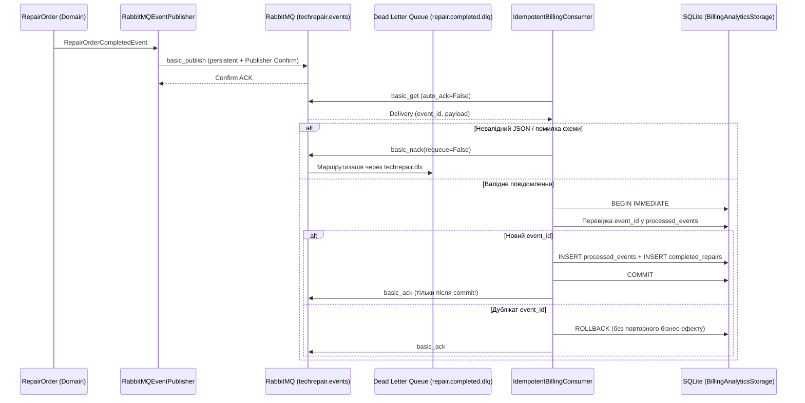
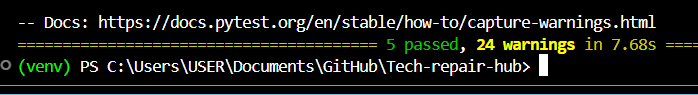

# Звіт з Лабораторної роботи №6

**Тема:** Подійна взаємодія та ідемпотентна обробка повідомлень  
**Проєкт:** TechRepair Hub (Система керування ремонтом комп'ютерної техніки)

---

## 1. Подія, учасники взаємодії та вимоги до порядку

* **Факт завершення операції (Подія):** `RepairOrderCompleted` (версія схеми `1.0`). Генерується після успішного завершення ремонту заявки у доменному агрегаті `RepairOrder` та публікується адаптером `RabbitMQEventPublisher`.
* **Споживач (Consumer):** `IdempotentBillingConsumer` (модуль фінансового обліку та аналітики), який атомарно фіксує дохід від виконаного ремонту у локальному сховищі SQLite (`BillingAnalyticsStorage`).
* **Модель події:** *Event-Carried State Transfer (ECST)* — подія переносить усі дані про техніку та фінальну вартість, щоб споживач міг оновити власну проєкцію без синхронних зворотних викликів до сервісу ремонту.

### Діаграма взаємодії



### Схема події `RepairOrderCompleted` (`v1.0`)

```json
{
  "event_id": "c7a9d41e-5b20-4f8a-9c12-8e4b71a03f99",
  "event_type": "RepairOrderCompleted",
  "schema_version": "1.0",
  "occurred_at": "2026-11-24T15:30:00.123456+00:00",
  "order_id": "550e8400-e29b-41d4-a716-446655440000",
  "data": {
    "brand": "Apple",
    "model": "MacBook Air",
    "serial_number": "SN-001",
    "final_cost": 2000.0,
    "currency": "UAH"
  }
}
```

### Вимоги до порядку та допустимість застарілої події
* **Порядок доставки:** Оскільки `RepairOrderCompleted` є фінальним фактом закриття окремої заявки, суворий глобальний порядок між різними замовленнями не потрібен.
* **Застарілі та повторні події:** Повторна або затримана доставка події з тим самим `event_id` є безпечною завдяки перевірці унікального первинного ключа `event_id` у таблиці `processed_events` та обмеженню `UNIQUE` на `order_id` у `completed_repairs`.

---

## 2. Конфігурація брокера, сховища та обробки помилок

* **Стенд (`docker-compose.yml`):** Локальний брокер `rabbitmq:3.13.7-management-alpine` (порти `5672` та `15672`).
* **Надійність доставки (`src/messaging/publisher.py`):**
  * `durable=True` для exchange `techrepair.events`, черги `repair.completed.queue`, а також `techrepair.dlx` та `repair.completed.dlq`.
  * `delivery_mode=2` (persistent-повідомлення) та `confirm_delivery()` (Publisher Confirms).
* **Атомарність та збереження стану (`src/messaging/storage.py`):**
  * Таблиці `processed_events` та `completed_repairs` оновлюються в одній транзакції SQLite (`BEGIN IMMEDIATE` $\rightarrow$ `COMMIT`).
  * Файл БД зберігається на диску, тому реєстр оброблених `event_id` переживає перезапуск споживача.
  * Ручний `basic_ack` виконується виключно після успішного `conn.commit()`.
* **Обробка помилок (`src/messaging/consumer.py`):**
  * Невалідні повідомлення отримують `basic_nack(requeue=False)` і через Dead Letter Exchange потрапляють у `repair.completed.dlq`.
  * Тимчасові помилки повторюються обмежену кількість разів (`max_retries=3`, `retry_delay=0.05s`); після вичерпання спроб повідомлення та причина помилки зберігаються в таблицю `failed_messages`.

---

## 3. Результати автоматичних перевірок (5 сценаріїв)

Запуск перевірок: `python -m pytest tests/test_eda_idempotency.py -v --log-cli-level=INFO` (`5 passed`).

| № | Сценарій перевірки | Очікуваний стан сховища / черги | Фактичний результат |
| :-: | :--- | :--- | :--- |
| **1** | **Успішна обробка** (`test_1_successful_event_processing`) | `completed_repairs = 1`, `processed_events = 1`, виручка `2000.0` | `PROCESSED`: 1 запис у БД, виручка `2000.0`, надіслано `ACK` |
| **2** | **Дві публікації з однаковим `event_id`** (`test_2_duplicate_event_id_is_idempotent`) | `completed_repairs = 1`, `processed_events = 1`, виручка `1800.0` | 1-ша: `PROCESSED`, 2-га: `DUPLICATE` (пропущено без змін БД) |
| **3** | **Збій до `commit` із повтором** (`test_3_failure_before_commit_recovers_on_retry`) | Транзакція відкочується, 2-га спроба фіксує `completed_repairs = 1` | Спроба 1: `TemporaryDatabaseError` (`ROLLBACK`), спроба 2: `PROCESSED` |
| **4** | **Зупинка після `commit` до `ACK` + перезапуск** (`test_4_crash_after_commit_before_ack_and_redelivery_after_restart`) | RabbitMQ повторно доставляє подію, але в БД лишається 1 запис (`3200.0`) | Після рестарту споживача: `DUPLICATE`, у БД рівно 1 запис (`3200.0`) |
| **5** | **Невалідне повідомлення в чергу помилок** (`test_5_invalid_message_routed_to_dlq`) | `completed_repairs = 0`, 1 повідомлення у `repair.completed.dlq` | `SENT_TO_DLQ`: у `repair.completed.dlq` зафіксовано 1 повідомлення |

### Фрагмент журналу виконання з `event_id`

```text
INFO     techrepair.consumer:consumer.py:92 [event_id=...] Подію успішно оброблено, ACK надіслано (order_id=...)
INFO     techrepair.consumer:consumer.py:99 [event_id=...] Виявлено дублікат події — пропущено без змін БД, ACK надіслано
WARNING  techrepair.consumer:consumer.py:109 [event_id=...] Тимчасова помилка (спроба 1/3): Керований збій БД до фіксації транзакції (commit)
ERROR    techrepair.consumer:consumer.py:85 [event_id=...] Збій процесу після commit до ACK!
WARNING  techrepair.consumer:consumer.py:61 Невалідне повідомлення відправлено у DLQ: 4 validation errors for RepairOrderCompletedEventMessage
```



---

## 4. Архітектурне рішення та висновок

* Детальне порівняння **RabbitMQ** та **Apache Kafka** для сценарію `TechRepair Hub`, а також опис проблеми подвійного запису (*Dual Write*) та патерну **Transactional Outbox** наведено у [`docs/adr/004-event-broker.md`](./adr/004-event-broker.md).
* **Висновок:** Реалізовано асинхронну взаємодію через локальний RabbitMQ зі збереженням повної незалежності доменного ядра від бібліотеки брокера (`pika`). Експериментально підтверджено, що поєднання атомарної транзакції SQLite (зберігання `event_id` разом із бізнес-результатом) та ручного `ACK` після `commit` надійно захищає систему від дублювання фінансових результатів при повторній доставці й аварійних перезапусках споживача.