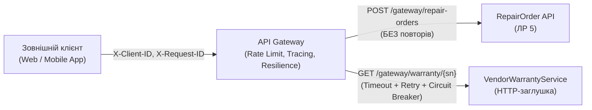
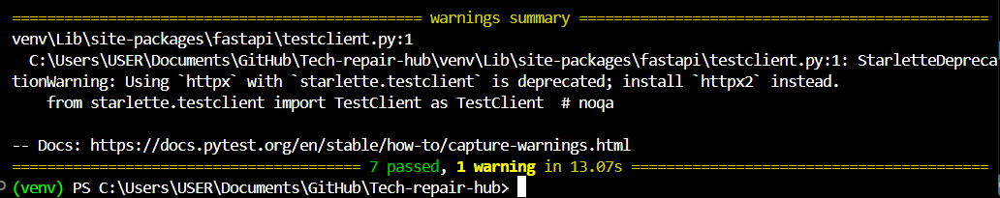

# Звіт з Лабораторної роботи №7

**Тема:** API Gateway та захист від каскадних відмов  
**Проєкт:** TechRepair Hub (Система керування ремонтом комп'ютерної техніки)

---

## 1. Межі компонентів, маршрути та BFF-адаптація

* **API Gateway (`src/gateway/gateway_app.py`):** Єдина зовнішня точка входу. Виконує наскрізні політики: генерацію та прокидання `X-Request-ID`, перевірку ліміту запитів (`Rate Limiting` по `X-Client-ID`), маршрутизацію та захист викликів до зовнішніх залежностей. Доменні правила залишаються у відповідних внутрішніх сервісах.
* **Внутрішні компоненти:**
  1. `RepairOrder API` (`src/api/app.py`, порт `18000` на стенді) — керування заявками на ремонт (`POST`, `GET`, `PATCH`).
  2. `VendorWarrantyService Stub` (`src/gateway/warranty_stub.py`, порт `18001` на стенді) — керована HTTP-заглушка перевірки гарантії виробника з налаштуванням затримки (`delay_sec`) та помилок (`fail_next_n`, `always_fail`).

### Діаграма компонентів і маршрутів



### Приклад BFF-адаптації для мобільного застосунку майстра-приймальника (Mobile BFF)

Для мобільного клієнта при прийомі пристрою на ремонт загальний шлюз потребував би двох окремих запитів і повертав би надлишкові службові поля. **Mobile BFF** (`GET /bff/mobile/intake-card/{order_id}`) агрегує дані з `RepairOrder API` та `VendorWarrantyService` в один компактний JSON:

```json
{
  "order_id": "550e8400-e29b-41d4-a716-446655440000",
  "status": "NEW",
  "device_title": "Apple MacBook Air (SN-1001)",
  "warranty_badge": "ACTIVE (до 2027-12-31)",
  "can_start_diagnostics": true
}
```

---

## 2. Політики стійкості та обробки помилок

* **Таймаути та Deadline (`src/gateway/resilience.py`):**
  * `per_attempt_timeout_sec = 0.15s` (на стенді; `0.20s` у конфігурації за замовчуванням) — максимальне очікування однієї спроби.
  * `overall_deadline_sec = 0.45s` (`0.65s` за замовчуванням) — сумарний бюджет часу на всі спроби.
* **Retry + Exponential Backoff + Jitter (тільки для читання `GET /gateway/warranty/{serial_number}`):**
  * `max_attempts = 3`, `base_backoff_sec = 0.04s`, `max_jitter_sec = 0.02s`.
  * **Дозволені для повтору помилки:** `httpx.TimeoutException`, `httpx.ConnectError`, а також HTTP-статуси `502`, `503`, `504`.
  * **Заборонені для повтору:** клієнтські помилки `400`, `401`, `403`, `404`, `422`, а також будь-які операції зміни стану (`POST /gateway/repair-orders`), для яких `allow_retry = False`.
* **Circuit Breaker:**
  * `failure_threshold = 3` (відкриття після 3 поспіль невдалих запитів).
  * `recovery_timeout_sec = 0.4s` (`1.0s` у базовій конфігурації) — час у стані `OPEN` (швидка відмова `503` без звернення до залежності).
  * `half_open_max_calls = 1` — пробний запит у стані `HALF_OPEN` для перевірки відновлення.
* **Rate Limiting:**
  * Алгоритм *Fixed Window* за заголовком `X-Client-ID`; при перевищенні ліміту повертається `429 Too Many Requests` із заголовком `Retry-After`.

---

## 3. Перевірка 5 сценаріїв поведінки та безпеки змін стану

Запуск перевірок: `python -m pytest tests/test_gateway_resilience.py -v -s --log-cli-level=INFO` (`7 passed`).

| № | Сценарій перевірки | HTTP-код | Тривалість (орієнтовно) | Фактичні виклики залежності | Поведінка шлюзу |
| :-: | :--- | :---: | :---: | :---: | :--- |
| **1** | **Нормальна відповідь** | `200 OK` | `~5–15 ms` | `1` | Успішна відповідь, прокинуто `X-Request-ID` |
| **2** | **Зависання в межах deadline** (`delay=0.25s`) | `504 Gateway Timeout` | `~450 ms` | `2–3` | Спрацювали `per_attempt_timeout` та `overall_deadline` |
| **3** | **Тимчасова помилка з успішним повтором** (`fail_next_n=2`) | `200 OK` | `~100–130 ms` | `3` | 2 невдалі спроби (`503`) + backoff/jitter, 3-тя успішна |
| **4a** | **Відкриття Circuit Breaker (`OPEN`)** | `503 Service Unavailable` | `< 5 ms` | `0` (після відкриття) | Миттєва відмова (Fast Fail) без навантаження на заглушку |
| **4b** | **Відновлення через `HALF_OPEN` $\rightarrow$ `CLOSED`** | `200 OK` | `~10 ms` | `1` (пробний) | Після паузи пропущено пробний запит, breaker закрився |
| **5** | **Перевищення Rate Limit** (`3 req / window`) | `429 Too Many Requests` | `< 5 ms` | `3` (4-й відсічено) | Шлюз повернув `429` із заголовком `Retry-After` |
| **6** | **Операція зміни стану (`POST`) при збої** | `503 Service Unavailable` | `< 10 ms` | `1` | Автоповтор вимкнено (`allow_retry=False`), дублікатів немає |

### Фрагмент журналу виконання з `request_id` (без токенів і персональних даних)

```text
INFO     techrepair.gateway:resilience.py:181 [request_id=req-retry-003] Виклик GET /api/v1/warranty/SN-RETRY (спроба 1/3, timeout=0.150s)
WARNING  techrepair.gateway:resilience.py:203 [request_id=req-retry-003] Тимчасова HTTP-помилка 503 на спробі 1/3
INFO     techrepair.gateway:resilience.py:249 [request_id=req-retry-003] Очікування backoff+jitter: 0.048s
WARNING  techrepair.gateway:resilience.py:143 [request_id=req-cb-fail-2] CircuitBreaker(VendorWarrantyService): CLOSED -> OPEN
WARNING  techrepair.gateway:resilience.py:143 [request_id=req-cb-probe] CircuitBreaker(VendorWarrantyService): OPEN -> HALF_OPEN
WARNING  techrepair.gateway:resilience.py:143 [request_id=req-cb-probe] CircuitBreaker(VendorWarrantyService): HALF_OPEN -> CLOSED
WARNING  techrepair.gateway:gateway_app.py:64 [request_id=req-rl-3] Rate limit перевищено для клієнта mobile-client-42
```

---

## 4. Порівняння серії з 30 запитів до та після захисту

Умова досліду: серія з **30 однакових запитів** `GET /gateway/warranty/SN-BENCH-{i}` за деградації зовнішньої залежності (`delay_sec = 0.12s`, `always_fail = True`, `503 Service Unavailable`). *Примітка: вимірювання зняті на локальному стенді та демонструють відносний ефект патернів стійкості, а не показники промислової доступності.*

| Режим роботи шлюзу | Успіхів (`200`) | Відмов (`503`) | Фактичних викликів залежності | Медіана часу відповіді (`median`) | Максимальний час відповіді (`max`) |
| :--- | :---: | :---: | :---: | :---: | :---: |
| **ДО захисту** (пряме проксіювання без CB/Deadline) | `0` | `30` | `30` | `~125–135 ms` | `~140–160 ms` |
| **ПІСЛЯ захисту** (Retry + Deadline + Circuit Breaker) | `0` | `30` | **`9`** *(зниження на 70%)* | **`< 5 ms`** *(Fast Fail у стані OPEN)* | `~450 ms` *(обмежено deadline)* |



---

## 5. Архітектурне рішення та висновок

* Аналіз компромісів між швидкою відмовою, додатковим навантаженням від повторів та шансом на відновлення оформлено в [`docs/adr/005-gateway-resilience.md`](./adr/005-gateway-resilience.md).
* **Висновок:** Додавання API Gateway перед сервісами `TechRepair Hub` дозволило винести наскрізні політики трасування (`X-Request-ID`), обмеження частоти запитів (`429`) та захисту від каскадних відмов за межі доменного ядра. Порівняльний експеримент на 30 запитах підтвердив, що поєднання *Deadline*, *Retry з Exponential Backoff + Jitter* (лише для безпечного читання) та *Circuit Breaker* скорочує навантаження на збійну залежність у понад 3 рази (з 30 до 9 викликів) і зменшує медіанний час відгуку шлюзу під час аварії до кількох мілісекунд.