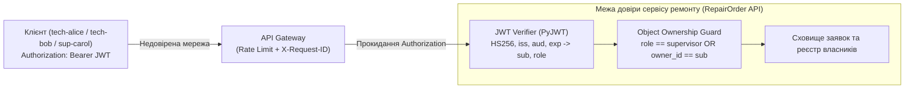
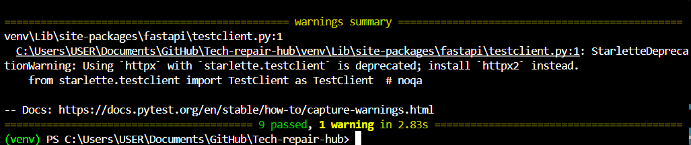
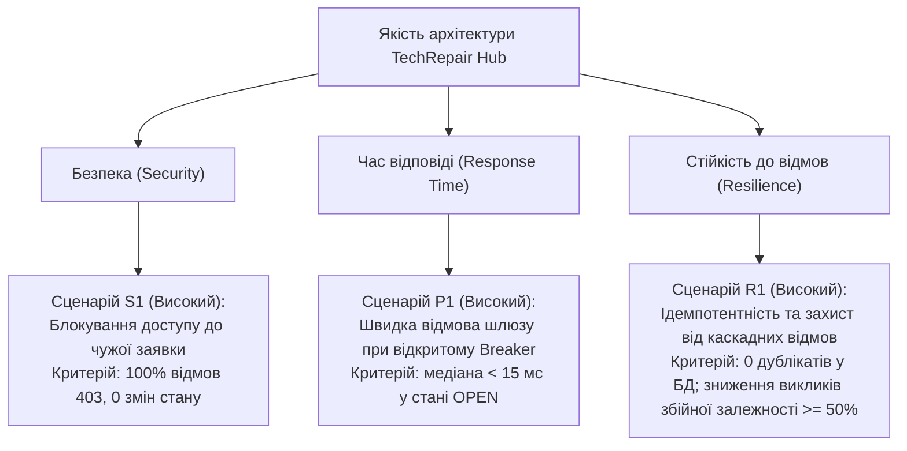

# Звіт з Лабораторної роботи №8

**Тема:** Контроль доступу та підсумкова оцінка архітектурних рішень  
**Проєкт:** TechRepair Hub (Система керування ремонтом комп'ютерної техніки)

---

## 1. Модель контролю доступу, межі довіри та матриця прав

### Ролі, синтетичні користувачі та правила володіння
* **Ролі:**
  1. `technician` — інженер з ремонту комп'ютерної техніки.
  2. `supervisor` — керівник сервісного центру.
* **Синтетичні облікові дані (генеруються локально в пам'яті, без секретів у Git):**
  * `tech-alice` (`role: "technician"`) та `tech-bob` (`role: "technician"`) — два користувачі з однаковою роллю для перевірки ізоляції володіння об'єктами.
  * `sup-carol` (`role: "supervisor"`) — керівник із розширеними правами.
* **Правило володіння об'єктами:** При створенні заявки (`POST /api/v2/repair-orders`) її власником (`owner_id`) фіксується `sub` із верифікованого JWT-токена. Інженер (`technician`) має право читати й оновлювати **лише власні** заявки (`order.owner_id == token.sub`), тоді як `supervisor` має доступ до всіх заявок і виключне право на видалення/анулювання (`DELETE`).

### Матриця контролю доступу

| Роль | Операція / Маршрут | Умова доступу | Код при порушенні |
| :--- | :--- | :--- | :---: |
| `technician` | `POST /api/v2/repair-orders` | Валідний JWT (`sub`, `role=technician`); `owner_id := token.sub` | `401 Unauthorized` |
| `technician` | `GET /api/v2/repair-orders/{id}` | Валідний JWT **та** `order.owner_id == token.sub` | `401` / `403 Forbidden` |
| `technician` | `PATCH /api/v2/repair-orders/{id}/status` | Валідний JWT **та** `order.owner_id == token.sub` | `401` / `403 Forbidden` |
| `technician` | `DELETE /api/v2/repair-orders/{id}` | **Заборонено** для ролі `technician` | `403 Forbidden` |
| `supervisor` | `POST / GET / PATCH / DELETE /api/v2/repair-orders/*` | Валідний JWT (`role=supervisor`), доступ до будь-якого `order_id` | `401 Unauthorized` |

### Схема меж довіри та місць перевірки прав

---

## 2. Результати автоматичних перевірок доступу (Завдання 2–3)

Запуск перевірок: `python -m pytest tests/test_access_control.py -v` (`9 passed`).

| № | Сценарій перевірки | Очікуваний код | Фактичний результат та перевірка незмінності стану |
| :-: | :--- | :---: | :--- |
| **1** | **Дозволений доступ** (`tech-alice` до своєї заявки, `sup-carol` до чужої) | `201` / `200` | Успішне створення, читання та переведення в `IN_DIAGNOSTICS` |
| **2** | **Відсутній токен** (`Authorization` не передано) | `401` | Відхилено (`401 Unauthorized`) |
| **3** | **Змінений підпис JWT** (модифіковано байт сигнатури) | `401` | Відхилено (`InvalidSignatureError` $\rightarrow$ `401`) |
| **4** | **Прострочений токен** (`exp` у минулому на 5 хв) | `401` | Відхилено (`ExpiredSignatureError` $\rightarrow$ `401`) |
| **5** | **Неправильна аудиторія** (`aud="another-external-service"`) | `401` | Відхилено (`InvalidAudienceError` $\rightarrow$ `401`) |
| **6** | **Неправильний емітент** (`iss="untrusted-identity-provider"`) | `401` | Відхилено (`InvalidIssuerError` $\rightarrow$ `401`) |
| **7** | **Заборонена роль** (`tech-alice` викликає `DELETE`) | `403` | Відхилено (`403 Forbidden`), заявка залишилася у статусі `NEW` |
| **8** | **Доступ до чужого об'єкта під тією самою роллю** (`tech-bob` $\rightarrow$ об'єкт `tech-alice`) | `403` | `GET` і `PATCH` відхилено (`403`), статус об'єкта власника залишився `NEW` |

---

## 3. Дерево якості (ATAM) та оцінка сценаріїв (Завдання 4)

| Атрибут якості | Сценарій та умови перевірки | Вимірюваний критерій | Пріоритет | Фактичний результат | Статус |
| :--- | :--- | :--- | :---: | :--- | :---: |
| **Безпека** | Користувач `tech-bob` (`technician`) намагається прочитати або змінити статус заявки, створеної `tech-alice` (`technician`), або видалити заявку | `100%` запитів відхиляються з кодом `403 Forbidden`; стан об'єкта у сховищі не змінюється | Високий | `GET` та `PATCH` повернули `403`; статус заявки залишився `NEW` (`test_8`) | **Виконано** |
| **Час відповіді** | Серія з 30 запитів через API Gateway при постійній деградації `VendorWarrantyService` (`delay=120ms`, `503`) з увімкненим Circuit Breaker | Медіанний час відповіді шлюзу в режимі захисту `< 15 мс` | Високий | Медіана зменшилася зі `~130 мс` до `< 5 мс` за рахунок Fast Fail у стані `OPEN` (ЛР 7) | **Виконано** |
| **Стійкість до відмов** | Повторна доставка події `RepairOrderCompleted` після рестарту споживача (ЛР 6) та серія з 30 збійних запитів до залежності (ЛР 7) | `0` повторних бізнес-результатів у SQLite; скорочення викликів збійної залежності `>= 50%` | Високий | У SQLite зафіксовано рівно `1` запис; кількість викликів залежності скоротилася з `30` до `9` (`-70%`) | **Виконано** |

---

## 4. Реєстр ризиків, точка чутливості та компроміс (Завдання 5)

### Реєстр архітектурних ризиків

| ID | Ризик | Наслідок | Спосіб перевірки або зменшення |
| :-: | :--- | :--- | :--- |
| **R-01** | **BOLA / IDOR (підміна `order_id` інженером тієї самої ролі)** | Несанкціонований перегляд або зміна чужої заявки на ремонт | Перевірка `owner_id == token.sub` у шарі застосунку (`_assert_order_access`), покрита тестом `test_8` |
| **R-02** | **Повторення неідемпотентної операції зміни стану при мережевому таймауті** | Створення дублікатів заявок або повторне списання коштів | Заборона автоповторів на шлюзі для `POST`/`PATCH` (`allow_retry=False`, ЛР 7) та дедуплікація за `event_id` у SQLite (ЛР 6) |
| **R-03** | **Втрата події між записом стану в БД та публікацією в RabbitMQ (Dual Write)** | Розбіжність між статусом заявки `COMPLETED` і даними фінансової аналітики | Описано патерн **Transactional Outbox** у `ADR 004` як обов'язковий крок перед промисловим впровадженням |

### Точка чутливості, компроміс та експеримент зі зміною параметра
* **Точка чутливості:** параметр таймауту однієї спроби `per_attempt_timeout_sec` на API Gateway відносно фактичного часу відповіді зовнішньої залежності (`delay_sec`).
* **Архітектурний компроміс:** Зменшення `per_attempt_timeout_sec` прискорює виявлення зависання та звільняє потоки шлюзу (*швидка відмова*), але підвищує ризик помилкового відхилення повільних, проте коректних відповідей залежності (*зниження доступності при пікових затримках*).
* **Експериментальна перевірка (`test_sensitivity_point_timeout_parameter_experiment`):**
  * Зафіксовано затримку відповіді залежності `delay_sec = 0.18s` (180 мс).
  * **Замір 1 (`per_attempt_timeout_sec = 0.25s`):** таймаут перевищує затримку залежності $\rightarrow$ шлюз успішно отримує відповідь (`200 OK`).
  * **Замір 2 (`per_attempt_timeout_sec = 0.10s`):** таймаут менший за час обробки залежності $\rightarrow$ усі спроби обриваються за таймаутом, і клієнт отримує `504 Gateway Timeout`.

---

## 5. Підсумкові ADR та висновок (Завдання 6)

* Політику контролю доступу зафіксовано у [`docs/adr/006-access-control-policy.md`](./adr/006-access-control-policy.md).
* Підсумкове уточнення архітектури та ревізію рішення першого модуля (`ADR 002`) оформлено у [`docs/adr/007-architecture-refinement.md`](./adr/007-architecture-refinement.md).
* **Висновок:** Архітектура **TechRepair Hub** пройшла повний цикл проєктування, реалізації та перевірки атрибутів якості (модульність DDD, транзакційна узгодженість Saga, контрактна сумісність REST API, ідемпотентна обробка подій у RabbitMQ, захист від каскадних відмов на API Gateway та контроль доступу на рівні ролей і об'єктів за допомогою JWT).